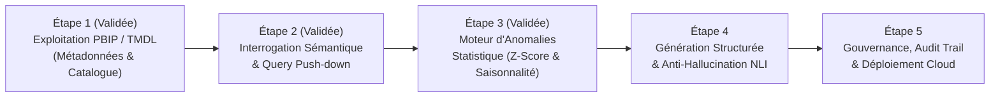

# Plan de Modernisation & Guide d'Exécution du Projet

Ce document récapitule la feuille de route architecturale, l'alignement avec les directives du professeur, ainsi que le guide pas à pas pour exécuter le projet et observer les étapes dans le terminal.

---

## 1. Philosophie et Alignement avec le Professeur

Le projet applique le principe directeur de la Business Intelligence Augmentée :
> **« Le code calcule, le LLM raconte, l'humain valide. »**

### Pourquoi cette architecture ?
1. **Rejet de l'injection du `.pbix`** : Le format `.pbix` est un conteneur binaire propriétaire opaque, inexploitable directement par un script ou une IA.
2. **Rejet du calcul des KPI dans la base SQL amont** : Recalculer les indicateurs en SQL brise l'unique source de vérité (*Single Source of Truth*) et duplique inutilement la logique DAX.
3. **Approche Recommandée Adoptée** : **Combinaison de l'exploitation du format PBIP (TMDL) avec l'interrogation du modèle sémantique Power BI (DAX).**

---

## 2. Feuille de Route (Plan en 5 Étapes)



### Détail des Étapes Réalisées :

* **Étape 1 — Exploitation PBIP / TMDL (`src/semantic_model.py`) :**
  * Parseur complet des 10 tables TMDL (`Sales.tmdl`, `Date.tmdl`, etc.).
  * Extraction des formules DAX exactes (`[Sales] - [Cost]`) et des descriptions métiers.
  * Extraction des relations du modèle (axe temporel actif : `Sales[OrderDateKey] -> Date[DateKey]`).
  * Injection du contexte sémantique certifié dans le prompt du LLM.

* **Étape 2 — Interrogation Sémantique & Query Push-down (`src/powerbi.py`) :**
  * Générateur DAX dynamique (`build_analysis_dax`) : pousse les filtres utilisateur (`Channel`, `Group`, `Category`, `Dates`) directement dans le moteur *VertiPaq* via `SUMMARIZECOLUMNS` et `FILTER`.
  * Support de l'API REST Cloud officielle Microsoft Fabric (`Execute Queries` avec token OAuth2).
  * Mode autonome de secours : bascule automatique sur le snapshot certifié du modèle si Power BI Desktop n'est pas ouvert en local.

* **Étape 3 — Moteur d'Anomalies Statistique & Adaptatif (`src/detect.py`) :**
  * Calcul de l'écart-type mobile $\sigma$ et du **$Z$-score** officiel sur la marge ($Z = \frac{\text{Marge} - \mu}{\sigma}$).
  * Qualification d'une sévérité objective (`critical`, `high`, `moderate`) intégrée au dashboard.
  * Détection de motifs saisonniers par comparaison glissante avec le même mois de l'année précédente ($M-12$).

---

## 3. Guide de Lancement du Projet

### Option A : Lancer le Tableau de Bord Streamlit (Interface Web)

Ouvrez un terminal PowerShell et exécutez :

```powershell
cd c:\Enis\3eme\BI\sujet15_exec_summary\sujet15_exec_summary
..\.venv\Scripts\streamlit.exe run app.py
```

Le tableau de bord s'ouvre automatiquement dans votre navigateur à l'adresse : **`http://localhost:8501`**.

> **Note sur la connexion Power BI :**  
> * Si **Power BI Desktop** est ouvert : l'application s'y connecte en direct.  
> * Si **Power BI Desktop** est fermé : l'application utilise automatiquement le snapshot certifié du modèle sans planter.

---

### Option B : Lancer en Ligne de Commande (Batch & Scénarios)

Pour exécuter un scénario pré-configuré sans interface graphique :

```powershell
cd c:\Enis\3eme\BI\sujet15_exec_summary\sujet15_exec_summary

# Exécution du scénario S01 avec le fournisseur Groq :
..\.venv\Scripts\python.exe -m src.pipeline --scenario S01 --provider groq

# Exécution avec push-down de filtres personnalisés :
..\.venv\Scripts\python.exe -m src.pipeline --channel Reseller --start 2018-01 --end 2018-12
```

---

## 4. Déroulement Pas à Pas Visible dans le Terminal

À chaque interaction dans l'application, le terminal affiche en temps réel les **6 étapes clés** du pipeline :

```text
=================================================================
  [ÉTAPE 1/6] MODÈLE SÉMANTIQUE & EXTRACTION DAX
=================================================================
[INFO] Connexion au modèle sémantique Power BI...
[OK] Extraction terminée : 461 lignes récupérées (0.05 secondes)
[OK] Dataset disponible : 461 lignes.

=================================================================
  [ÉTAPE 2/6] FILTRAGE DU PÉRIMÈTRE (SCOPE & PUSH-DOWN)
=================================================================
[INFO] Application des filtres sélectionnés...
[OK] Filtrage terminé : 48 lignes conservées (0.01 secondes)

=================================================================
  [ÉTAPE 3/6] ANALYSE DÉTERMINISTE & DÉTECTION D'ANOMALIES
=================================================================
[INFO] Exécution du moteur de détection des anomalies...
[OK] Détection terminée : 2 anomalie(s) détectée(s) (0.02 secondes)
   - A01 | R1_margin_alert | 2019-07 | negative | Sévérité: critical (Z = -3.1)
   - A02 | R4_channel_gap  | whole scope | structural
[OK] Préparation des résultats terminée.
```

Lorsque l'utilisateur clique sur **« Generate summary »** :

```text
=================================================================
  [ÉTAPE 4/6] GÉNÉRATION DU RÉSUMÉ EXÉCUTIF PAR LE LLM
=================================================================
[INFO] Envoi du payload au fournisseur IA : groq
[INFO] Contexte sémantique TMDL injecté (Mesures DAX certifiées)
[INFO] Génération du résumé exécutif...
[OK] Résumé exécutif généré (1.42 secondes)
[INFO] Génération de l'explication des anomalies...
[OK] Explication des anomalies générée (1.18 secondes)

=================================================================
  [ÉTAPE 5/6] CONTRÔLE DE SÉCURITÉ & ANTI-HALLUCINATION
=================================================================
[INFO] Vérification des chiffres du texte IA...
[OK] Vérification terminée : 12 chiffres vérifiés et conformes au JSON

=================================================================
  [ÉTAPE 6/6] VALIDATION HUMAINE & EXPORT DU RAPPORT PDF
=================================================================
[INFO] Enregistrement de la décision humaine...
[OK] Décision enregistrée : VALIDATED
[OK] Rapport PDF créé : outputs/app_Europe_2019_report.pdf
```
